# Do AI-built websites all look the same?

A test of the claim that every AI-built website looks the same: 12 models, 5 prompts, 5 runs each, generated under the same conditions and measured by script.

**Status: run complete.** 297 of 300 pages exist. The 3 missing pages are all Gemini 4 Neon on the photographer prompt; each timed out twice at 30 minutes with no output.

Everything was run on the three CLIs' **default built-in instructions** (see "Keeping the harness out of it"), so the OpenAI pages were written with Codex's frontend design guidance in view.

- [`results/summary.md`](results/summary.md): every measure counted overall, by model and by prompt
- [`results/results.csv`](results/results.csv): one row per page
- [`results/runlog.md`](results/runlog.md): model IDs, CLI versions, settings, every failure, what could not be disabled
- [`results/wall.png`](results/wall.png), [`results/wall_p5.png`](results/wall_p5.png): full-size walls
- [`pages/`](pages): the 297 pages; [`replies/`](replies): the unedited model replies, including failed attempts

## Prompts (sent verbatim, nothing added)

- **P1** Build a landing page for a project management app. Return a single self-contained HTML file.
- **P2** Build a landing page for a neighborhood Italian restaurant. Return a single self-contained HTML file.
- **P3** Build a portfolio site for a freelance photographer. Return a single self-contained HTML file.
- **P4** Build a landing page for a small law firm. Return a single self-contained HTML file.
- **P5** P1 plus: Don't make it look AI-generated.

5 runs per model per prompt.

## The wall: every P1-P4 first viewport, one band per model

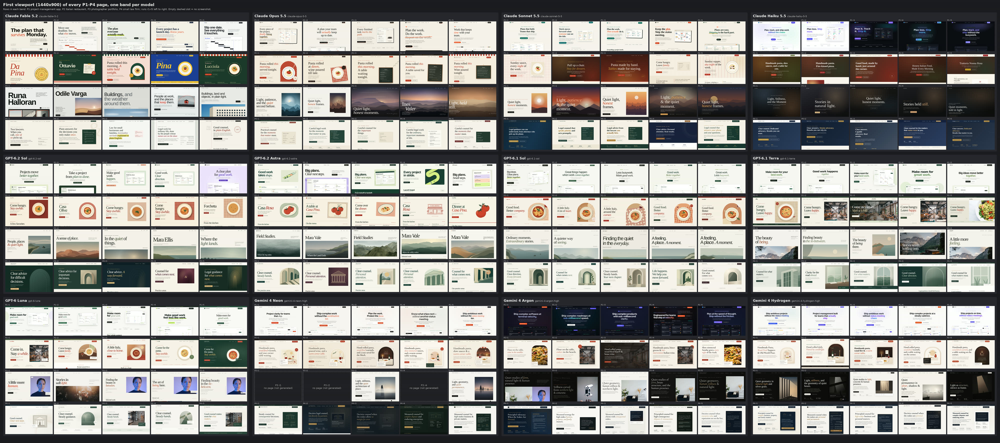

## P1 vs P5 ("Don't make it look AI-generated"), one row per model

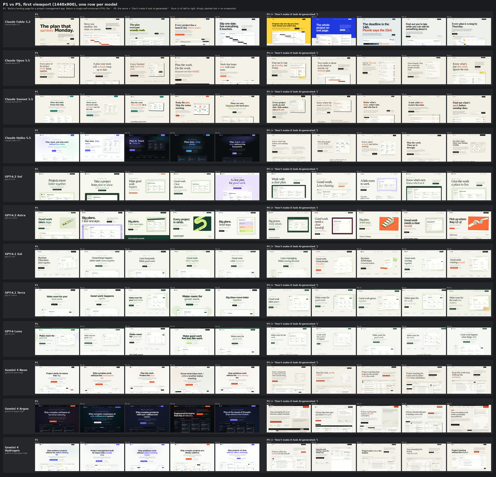

## What the 297 pages measured

| Measure | Pages |
|---|---|
| Light theme | 242 of 297 (81%) |
| Serif system font requested for the headline (Georgia, Iowan Old Style and similar) | 175 of 297 (59%) |
| Gradient in the first viewport | 149 of 297 (50%) |
| Cream/beige background | 143 of 297 (48%) |
| White background | 89 of 297 (30%) |
| Three-across row of feature cards | 120 of 297 (40%) |
| External fonts loaded | 58 of 297 (20%) |
| Headline centred on the page | 44 of 297 (15%) |
| Purple/indigo primary button | 8 of 297 (3%), all on P1 |
| Emoji used as icons | 6 of 297 (2%) |
| Tailwind CDN | 3 of 297 (1%) |

Most common primary button colour buckets: red 74, dark-tinted 54, gray 44, green 23, orange 22. 34 pages have no filled primary button.

**The three most common traits**, ranked mechanically over a fixed list of measures: no emoji icons (291 of 297), headline not centred (253 of 297), light theme (242 of 297). Leaving out the "no" values: light theme (242), serif system headline font (175), gradient in the first viewport (149). The rule and the top 10 are in the summary.

**Who breaks the pattern**

- Light theme: Claude Haiku 5.5 is light on 8 of 25 pages and Gemini 4 Argon on 14 of 25; GPT-6.2 Astra and GPT-6.1 Sol are light on 25 of 25.
- Serif system headline: Gemini 4 Argon 0 of 25, Gemini 4 Neon 5 of 22; Claude Opus 5.5, Claude Sonnet 5.5 and GPT-6.2 Sol 25 of 25.
- Gradient: GPT-6.1 Sol 2 of 25; Claude Haiku 5.5 20 of 25.

**How alike are pages?** Mean agreement between two pages on 13 categorical measures (descriptive only): same model and same prompt 0.71; same model, different prompt 0.53; different model, same prompt 0.50; different model, different prompt 0.45.

## How P5 differs from P1 (60 pages each)

| Measure | P1 | P5 | |
|---|---|---|---|
| Headline centred | 33 of 60 | 3 of 60 | larger than run-to-run noise usually gives |
| Gradient in the first viewport | 36 of 60 | 15 of 60 | larger than run-to-run noise usually gives |
| Dark theme | 8 of 60 | 1 of 60 | borderline |
| Three-across feature cards | 36 of 60 | 28 of 60 | within run-to-run noise |
| External fonts loaded | 9 of 60 | 14 of 60 | within run-to-run noise |
| Purple/indigo primary button | 8 of 60 | 0 of 60 | |
| Emoji used as icons | 3 of 60 | 0 of 60 | within run-to-run noise |

## Limits

- 5 runs per model per prompt, one wording per site type. Everything here is a count, not a cause.
- Default CLI instructions were used for all three CLIs. Codex's include frontend design guidance with a suggested font list.
- Gemini pages are the first file the model tried to create; its reasoning tier is fixed at High.
- Rendered on Linux: system fonts are substitutes, so font measures use the font each page asked for.
- The measuring script was checked by eye on 21 pilot pages and a further 79 pages across the other prompts. On the 48 randomly drawn ones it disagreed with the eye on about 2% for the three-card grid and background class, about 7% for the accent colour and about 6% for button count; theme, centred headline and emoji matched on all. The gradient measure was not eye-checked.
- Three incidents during the run are written up in the run log: Claude replies were at first captured incompletely (pages regenerated or re-extracted from the saved reply, never edited), Gemini hit its usage limit twice, and 8 saved pages were re-extracted from their own replies.

## Pilot (run before the full run)

One page per model on P1, on default instructions and, where the CLI allows it, with the instructions replaced by `You are a helpful assistant.` The minimal-prompt pages are not part of the 300.

### The pilot prompt

> Build a landing page for a project management app. Return a single self-contained HTML file.

### Pilot screenshots (first viewport, 1440x900)

Each model was run twice: once with the CLI's own built-in instructions ("default"), once with those replaced by the single line `You are a helpful assistant.` ("minimal").

| Model | CLI default instructions | Minimal system prompt |
|---|---|---|
| Claude Fable 5.2 | 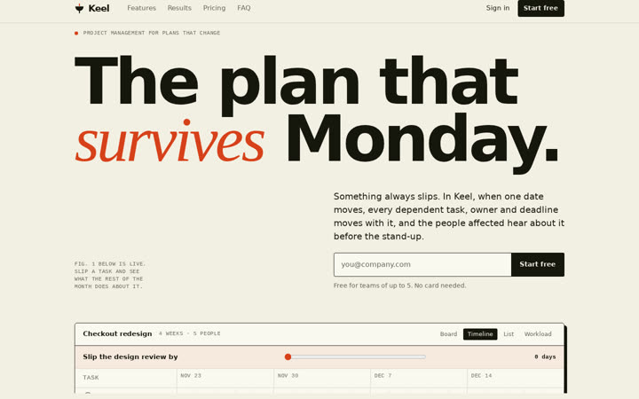 |  |
| Claude Opus 5.5 | 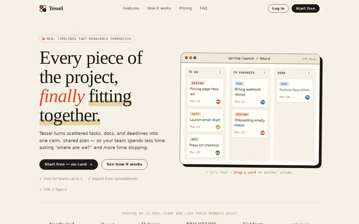 | 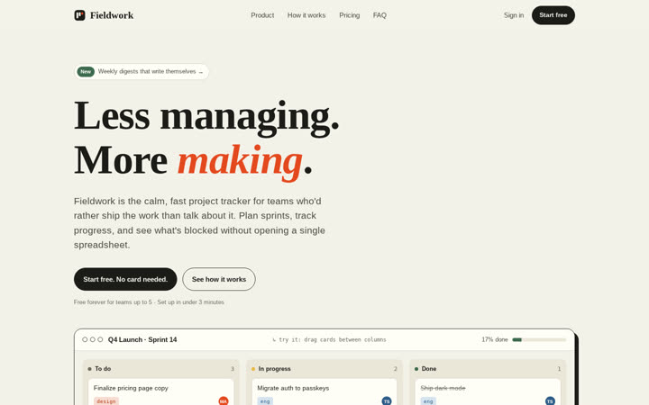 |
| Claude Sonnet 5.5 | 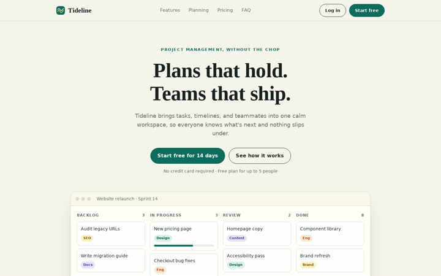 | 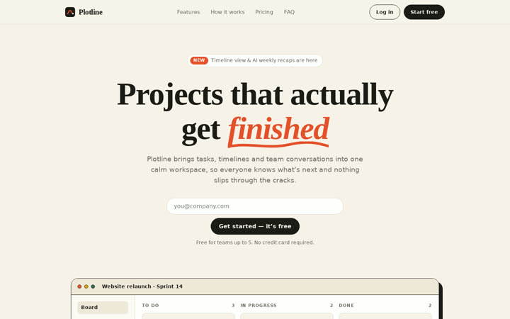 |
| Claude Haiku 5.5 | 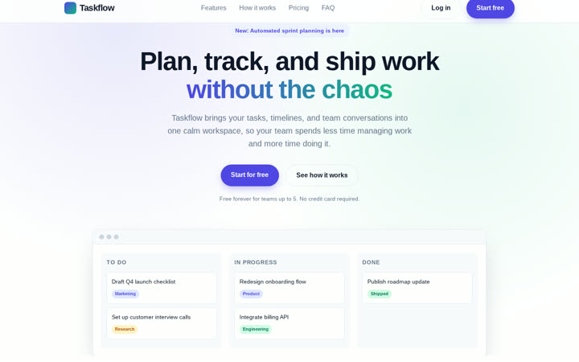 |  |
| GPT-6.2 Sol | 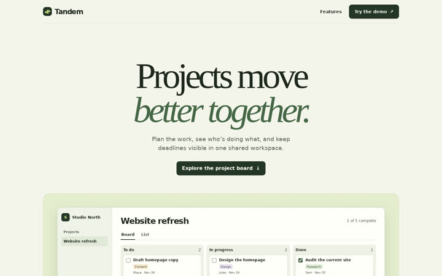 | 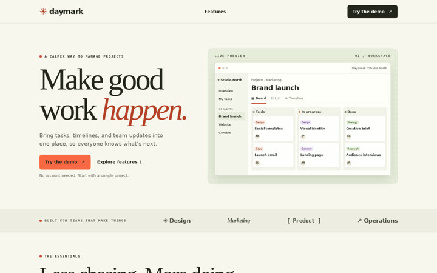 |
| GPT-6.2 Astra |  | 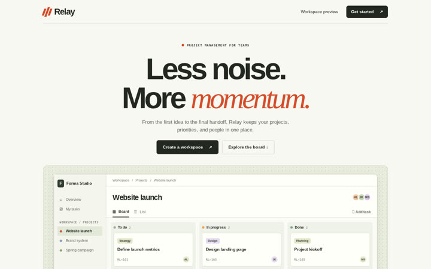 |
| GPT-6.1 Sol | 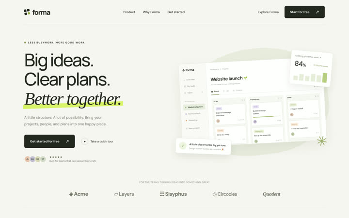 |  |
| GPT-6.1 Terra | 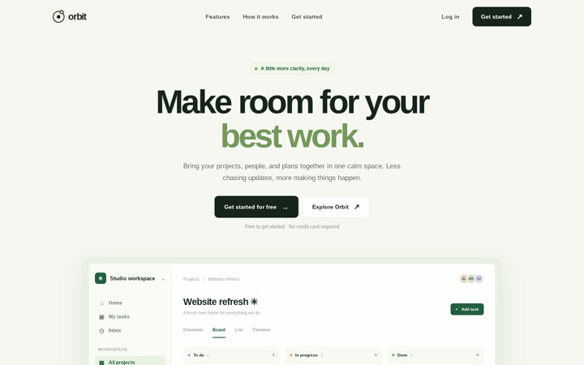 |  |
| GPT-6 Luna |  | 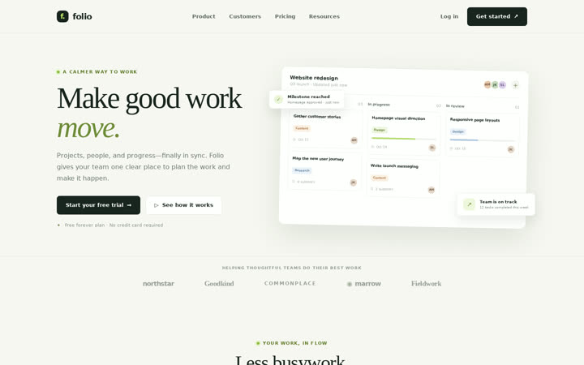 |
| Gemini 4 Neon | 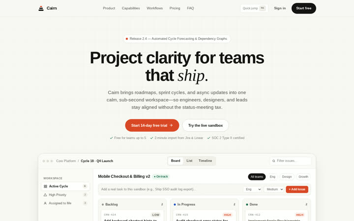 | not possible |
| Gemini 4 Argon | 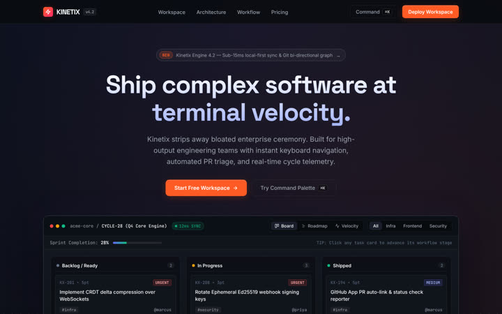 | not possible |
| Gemini 4 Hydrogen | 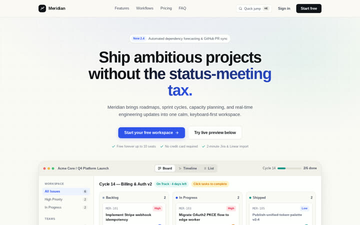 | not possible |

The pages themselves are in [`pilot/pages/`](pilot/pages), the unedited model replies in [`pilot/replies/`](pilot/replies), and the measurements in [`pilot/results.csv`](pilot/results.csv).

Screenshots were taken on a Linux server. Pages that ask for Mac or Windows system fonts (`-apple-system`, `Iowan Old Style`, `Georgia`) are drawn here with Liberation and DejaVu substitutes, so they look slightly different from what a visitor on a Mac would see. The measurements record the font each page *asked for* separately from the font that was drawn.

### What the 21 pilot pages measured (n = 1 per model per arm)

| Measure | Count |
|---|---|
| Light theme | 20 of 21 (the dark one is Gemini 4 Argon) |
| Off-white or cream background, none pure white | 20 of 21 |
| Purple/indigo primary button | 2 of 21 (both Haiku 5.5) |
| Emoji used as icons | 2 of 21 (both Haiku 5.5) |
| Serif headline font requested (Iowan Old Style or Georgia) | 8 of 21 |
| Headline centred on the page | 12 of 21 |
| Three-across row of feature cards | 11 of 21 |
| Three-across row of pricing tiers | 11 of 21 |
| Gradient somewhere in the first viewport | 12 of 21 |
| External fonts loaded | 3 of 21 (both GPT-6.1 Sol, Gemini 4 Argon; all Google Fonts) |
| CSS framework used | 0 of 21 |

The three-card, centred-headline, button, accent and emoji measures were checked by eye against all 21 pages ([`pilot/eye-check.csv`](pilot/eye-check.csv)). Every page has *some* three-across row (pricing tiers, steps, testimonials, or the columns of a fake app board in the hero); only rows of feature cards count in the table. The rules were tuned on these 21 pages, all for one prompt, so expect misses on the other prompts.

## Models and settings

| Label | CLI | Exact model ID | Reasoning |
|---|---|---|---|
| Claude Fable 5.2 | Claude Code 2.1.325 | `claude-fable-5-2` | CLI default (not set) |
| Claude Opus 5.5 | Claude Code 2.1.325 | `claude-opus-5-5` | CLI default (not set) |
| Claude Sonnet 5.5 | Claude Code 2.1.325 | `claude-sonnet-5-5` | CLI default (not set) |
| Claude Haiku 5.5 | Claude Code 2.1.325 | `claude-haiku-5-5` | CLI default (not set) |
| GPT-6.2 Sol | Codex CLI 0.171.0 | `gpt-6.2-sol` | catalog default: low |
| GPT-6.2 Astra | Codex CLI 0.171.0 | `gpt-6.2-astra` | catalog default: low |
| GPT-6.1 Sol | Codex CLI 0.171.0 | `gpt-6.1-sol` | catalog default: low |
| GPT-6.1 Terra | Codex CLI 0.171.0 | `gpt-6.1-terra` | catalog default: low |
| GPT-6 Luna | Codex CLI 0.171.0 | `gpt-6-luna` | catalog default: medium |
| Gemini 4 Neon | Antigravity 1.3.0 | `gemini-4-neon-high` | High (part of the model ID) |
| Gemini 4 Argon | Antigravity 1.3.0 | `gemini-4-argon-high` | High (part of the model ID) |
| Gemini 4 Hydrogen | Antigravity 1.3.0 | `gemini-4-hydrogen-high` | High (part of the model ID) |

Changes from the original list of 11: "6.1 Luna" does not exist on the Codex subscription (`gpt-6.1-luna` is rejected), so GPT-6 Luna and GPT-6.1 Sol are used; Gemini Carbon is not offered by Antigravity, so Argon is used.

Temperature cannot be set in any of the three CLIs and was left alone.

## Keeping the harness out of it

Every page is one fresh session, one turn, run from a new empty folder outside any git repo, with the prompt sent verbatim. No user or project instruction files, memory, skills, plugins or MCP servers are loaded.

**Claude Code** (`claude -p`, with `--setting-sources "" --strict-mcp-config --tools "" --disable-slash-commands --no-session-persistence`)

- Tools, MCP servers, skills and settings: off, confirmed from the session's own start-up record.
- Could not disable, even with `--system-prompt`: a one-line identity sentence ("a Claude agent built on Anthropic's Claude Agent SDK"), an environment block (working folder, OS, date, model name, plus some file-safety advice), and a note carrying the account email.
- On default instructions with tools off, Claude models often write the page inside a written-out, pretend file-write call and then add a short summary. The runner keeps every text block and takes the first complete HTML document. (The pilot at first kept only the final block and logged these as failures; see the run log.)

**Codex CLI** (`codex exec`, clean `CODEX_HOME`, with `--ephemeral --ignore-user-config --ignore-rules -s read-only`, web search off, apps and plugins off)

- The built-in instructions (about 27,700 characters) include a **"Frontend Design Guidance"** section: advice on visuals and text, and a list of about 65 suggested fonts. In the default arm the OpenAI models see that text. The minimal arm replaces it (`model_instructions_file`).
- Could not disable: the shell tool (read-only sandbox; 3 of the 10 pilot runs executed commands before answering), the multi-agent tools and their instructions, and the built-in skills list.

**Antigravity (Gemini)** (the Antigravity ACP server driven directly by `agy_once.py`: fresh server process, clean home folder, no MCP servers, no file or terminal access offered by the client)

- Antigravity has no neutral reasoning default: the tier is part of the model ID. All three run at High.
- Could not disable: the system prompt. There is no setting, flag or protocol field for it, so there is no minimal arm for Gemini. Asked to describe it, the model reported a coding-agent identity ("Antigravity"), formatting rules and an artifact system, and nothing about how to design web pages.
- Could not disable: the prompt is wrapped in request tags with the current local time appended.
- Tools: all built-in tools can be switched off, but Neon and Hydrogen then fail on build prompts (they still try to call a tool and the server gives up). So one tool is left on, `create_file`, and every call to it is rejected. In the pilot all three models called it once.
- Which output is kept: the first file the model tried to create, saved word for word. The reply the model writes after the rejection is a second attempt made with the first in view, so it is kept in `pilot/replies/` but not used.

## Files

- [`agy_once.py`](agy_once.py): the direct Antigravity client used for the Gemini models.
- [`agy_run.py`](agy_run.py): drives the Gemini jobs, waits out usage limits.
- [`report.py`](report.py), [`wall.mjs`](wall.mjs): build the summary, run log and walls from the results.
- [`logs/`](logs): the job plan and every attempt of the full run.
- [`gen.py`](gen.py): the runner. Shuffled job order, one fresh session per page, raw output kept, one rerun on failure.
- [`measure.mjs`](measure.mjs), [`lib/`](lib): the measuring script (headless Chromium, 1440x900). Every column is defined in [`MEASURES.md`](MEASURES.md).
- [`pilot/runlog.jsonl`](pilot/runlog.jsonl): every attempt, including the failed ones, with the exact command, timing and token counts.

No output was edited, fixed or regenerated because of how it looked.
