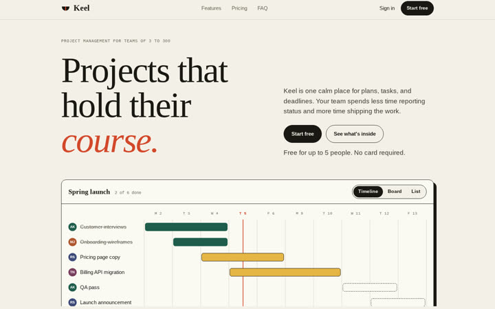
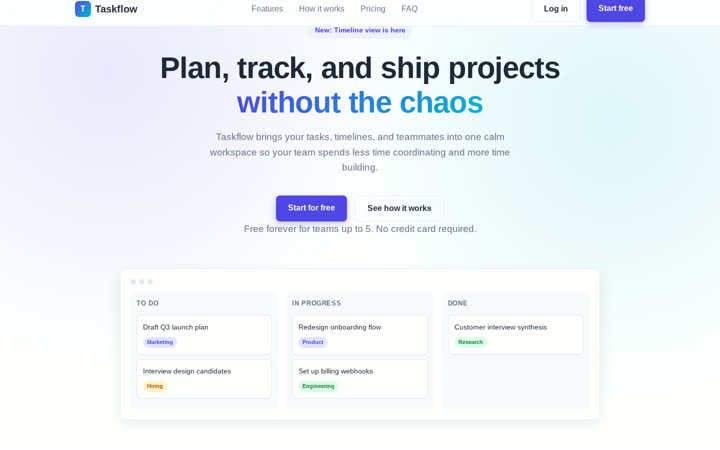
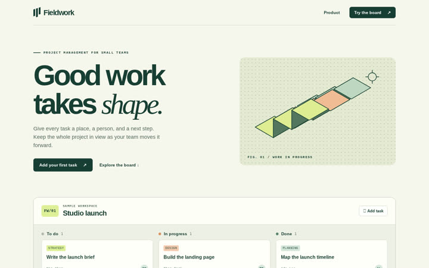
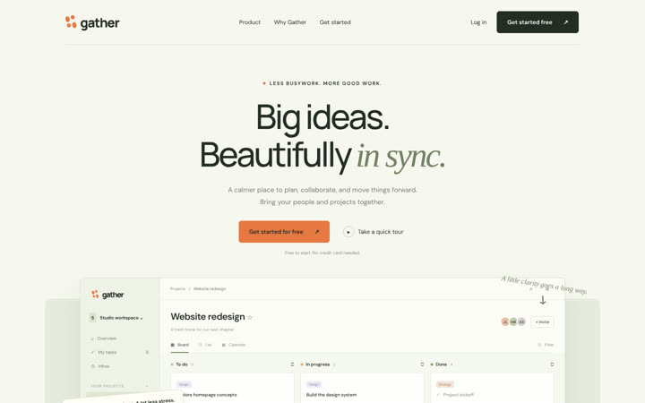
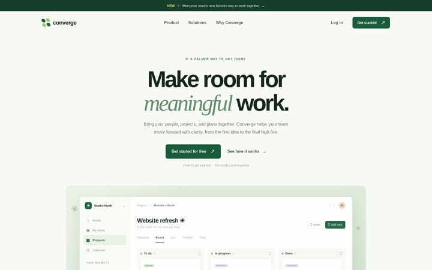
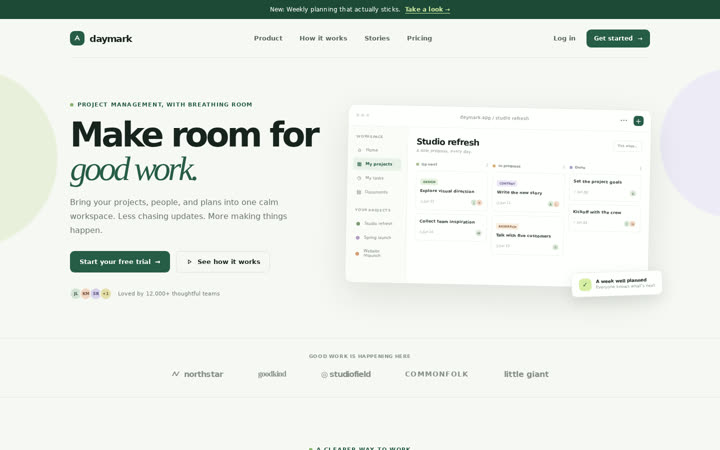

# Do AI-built websites all look the same?

A test of the claim that every AI-built website looks the same: 12 models, 5 prompts, 5 runs each, generated under the same conditions and measured by script.

**Status: pilot only.** One page per model on prompt P1, for the 9 Claude and OpenAI models. The Gemini models and the full 300-page run are not done yet. Nothing below is a result; with one page per model it is a first look.

## The pilot prompt (sent verbatim, nothing added)

> Build a landing page for a project management app. Return a single self-contained HTML file.

## Pilot screenshots (first viewport, 1440x900)

Each model was run twice: once with the CLI's own built-in instructions ("default"), once with those replaced by the single line `You are a helpful assistant.` ("minimal").

| Model | CLI default instructions | Minimal system prompt |
|---|---|---|
| Claude Fable 5.2 |  |  |
| Claude Opus 5.5 |  |  |
| Claude Sonnet 5.5 |  |  |
| Claude Haiku 5.5 |  |  |
| GPT-6.2 Sol |  |  |
| GPT-6.2 Astra |  |  |
| GPT-6.1 Sol |  |  |
| GPT-6.1 Terra |  |  |
| GPT-6 Luna |  |  |

The pages themselves are in [`pilot/pages/`](pilot/pages), the unedited model replies in [`pilot/replies/`](pilot/replies), and the measurements in [`pilot/results.csv`](pilot/results.csv).

Screenshots were taken on a Linux server. Pages that ask for Mac or Windows system fonts (`-apple-system`, `Iowan Old Style`, `Georgia`) are drawn here with Liberation and DejaVu substitutes, so they look slightly different from what a visitor on a Mac would see. The measurements record the font each page *asked for* separately from the font that was drawn.

## What the 18 pilot pages measured (n = 1 per model per arm)

| Measure | Count |
|---|---|
| Light theme | 18 of 18 |
| Off-white or cream background (none pure white, none dark) | 18 of 18 |
| Purple/indigo primary button | 2 of 18 (both Haiku 5.5) |
| Emoji used as icons | 2 of 18 (both Haiku 5.5) |
| Serif headline font requested | 8 of 18 |
| External fonts loaded | 2 of 18 (both GPT-6.1 Sol, Google Fonts) |
| CSS framework used | 0 of 18 |

The script also flagged a three-across card row on all 18 pages. That rule has not been checked by eye against real pages yet, so it is not in the table.

## Models and settings

| Label | CLI | Exact model ID | Reasoning |
|---|---|---|---|
| Claude Fable 5.2 | Claude Code 2.1.325 | `claude-fable-5-2` | CLI default (not set) |
| Claude Opus 5.5 | Claude Code 2.1.325 | `claude-opus-5-5` | CLI default (not set) |
| Claude Sonnet 5.5 | Claude Code 2.1.325 | `claude-sonnet-5-5` | CLI default (not set) |
| Claude Haiku 5.5 | Claude Code 2.1.325 | `claude-haiku-5-5` | CLI default (not set) |
| GPT-6.2 Sol | Codex CLI 0.171.0 | `gpt-6.2-sol` | catalog default: low |
| GPT-6.2 Astra | Codex CLI 0.171.0 | `gpt-6.2-astra` | catalog default: low |
| GPT-6.1 Sol | Codex CLI 0.171.0 | `gpt-6.1-sol` | catalog default: low |
| GPT-6.1 Terra | Codex CLI 0.171.0 | `gpt-6.1-terra` | catalog default: low |
| GPT-6 Luna | Codex CLI 0.171.0 | `gpt-6-luna` | catalog default: medium |
| Gemini 4 Neon | Antigravity 1.3.0 | pending | pending |
| Gemini 4 Argon | Antigravity 1.3.0 | pending | pending |
| Gemini 4 Hydrogen | Antigravity 1.3.0 | pending | pending |

Changes from the original list of 11: "6.1 Luna" does not exist on the Codex subscription (`gpt-6.1-luna` is rejected), so GPT-6 Luna and GPT-6.1 Sol are used; Gemini Carbon is not offered by Antigravity, so Argon is used.

Temperature cannot be set in any of the three CLIs and was left alone.

## Keeping the harness out of it

Every page is one fresh session, one turn, run from a new empty folder outside any git repo, with the prompt sent verbatim. No user or project instruction files, memory, skills, plugins or MCP servers are loaded.

**Claude Code** (`claude -p`, with `--setting-sources "" --strict-mcp-config --tools "" --disable-slash-commands --no-session-persistence`)

- Tools, MCP servers, skills and settings: off, confirmed from the session's own start-up record.
- Could not disable, even with `--system-prompt`: a one-line identity sentence ("a Claude agent built on Anthropic's Claude Agent SDK"), an environment block (working folder, OS, date, model name, plus some file-safety advice), and a note carrying the account email.
- On default instructions with tools off, 3 of the 4 Claude models failed their first attempt: the reply described files it had "created" or contained written-out tool calls, with no HTML. Each returned HTML on the one permitted rerun in a fresh session. With the minimal system prompt, all 4 returned HTML first time.

**Codex CLI** (`codex exec`, clean `CODEX_HOME`, with `--ephemeral --ignore-user-config --ignore-rules -s read-only`, web search off, apps and plugins off)

- The built-in instructions (about 27,700 characters) include a **"Frontend Design Guidance"** section: advice on visuals and text, and a list of about 65 suggested fonts. In the default arm the OpenAI models see that text. The minimal arm replaces it (`model_instructions_file`).
- Could not disable: the shell tool (read-only sandbox; 3 of the 10 pilot runs executed commands before answering), the multi-agent tools and their instructions, and the built-in skills list.

**Antigravity (Gemini)**: pending. Through the T3 Code agent it was given extra tools and tried to open a browser to check its own page, so a direct client with no tools attached is being built.

## Files

- [`gen.py`](gen.py): the runner. Shuffled job order, one fresh session per page, raw output kept, one rerun on failure.
- [`measure.mjs`](measure.mjs), [`lib/`](lib): the measuring script (headless Chromium, 1440x900). Every column is defined in [`MEASURES.md`](MEASURES.md).
- [`pilot/runlog.jsonl`](pilot/runlog.jsonl): every attempt, including the failed ones, with the exact command, timing and token counts.

No output was edited, fixed or regenerated because of how it looked.
